# Faculty Evaluation System ERD

This diagram represents the tables and foreign keys in
[`faculty_evaluation_db (1).sql`](./faculty_evaluation_db%20(1).sql). Open this
Markdown file in a Mermaid-enabled preview to view the rendered ERD.

```mermaid
erDiagram
    ADD_PROGRAMS {
        int id PK
        varchar program_code UK
        varchar program_name
    }

    ADD_SUBJECTS {
        int id PK
        int program_id FK
        varchar subject_code
        varchar subject_desc
        varchar year_level
        enum semester
    }

    ADD_CLASSES {
        int id PK
        int program_id FK
        int period_id FK "nullable"
        varchar year_level
        varchar semester
        varchar block
    }

    ADD_CATEGORIES {
        int id PK
        varchar category_name
        varchar section_number UK
        decimal weight
    }

    ADD_QUESTIONS {
        int id PK
        int category_id FK
        text question_text
    }

    ADD_FACULTIES {
        int id PK
        varchar faculty_id UK
        varchar email
        varchar firstname
        varchar lastname
        varchar status
    }

    ADD_STUDENTS {
        int id PK
        varchar student_number UK
        varchar email UK
        varchar program
        varchar yearlevel
        varchar section
        varchar student_type
        varchar status
    }

    EVALUATION_PERIODS {
        int id PK
        varchar ay
        varchar semester
        date start_date
        date end_date
        boolean is_active
    }

    EVALUATION_SETTINGS {
        int id PK
        boolean evaluation_open
        int active_period_id FK "nullable"
        varchar selected_ay
        varchar selected_semester
        varchar display_ay
        varchar display_semester
    }

    CLASS_SUBJECTS {
        int id PK
        int class_id FK
        int subject_id FK
        int faculty_id FK
    }

    FACULTY_SUBJECTS {
        int id PK
        int faculty_id FK
        int subject_id FK
    }

    STUDENT_SUBJECTS {
        int id PK
        int student_id FK
        int subject_id FK
    }

    STUDENT_SUBJECT_CLASSES {
        int id PK
        int student_id FK
        int subject_id FK
        int class_id FK
    }

    EVALUATIONS {
        int id PK
        int student_id FK
        int faculty_id FK
        int subject_id FK
        int class_id FK
        int period_id FK "nullable"
        decimal overall_rating
        text feedback
    }

    EVALUATION_ANSWERS {
        int id PK
        int evaluation_id FK
        int question_id FK
        tinyint rating
    }

    FACULTY_LOGIN {
        int faculty_id PK, FK
        varchar faculty_username UK
        varchar faculty_password
    }

    STUDENT_LOGIN {
        int id PK
        varchar username UK, FK
        varchar password
    }

    FACULTY_UPLOADED_REPORTS {
        int id PK
        int faculty_id FK
        varchar academic_year
        varchar semester
        varchar file_name
        varchar file_path
    }

    ADMIN_LOGIN {
        int admin_id PK
        varchar admin_username UK
        varchar admin_password
    }

    PASSWORD_RESET_CODES {
        int id PK
        varchar email
        varchar code
        datetime expires_at
        boolean used
    }

    ADD_PROGRAMS ||--o{ ADD_SUBJECTS : offers
    ADD_PROGRAMS ||--o{ ADD_CLASSES : has
    EVALUATION_PERIODS o|--o{ ADD_CLASSES : schedules
    ADD_CATEGORIES ||--o{ ADD_QUESTIONS : contains

    ADD_CLASSES ||--o{ CLASS_SUBJECTS : includes
    ADD_SUBJECTS ||--o{ CLASS_SUBJECTS : assigned_as
    ADD_FACULTIES ||--o{ CLASS_SUBJECTS : teaches

    ADD_FACULTIES ||--o{ FACULTY_SUBJECTS : assigned_to
    ADD_SUBJECTS ||--o{ FACULTY_SUBJECTS : has_faculty_assignments
    ADD_STUDENTS ||--o{ STUDENT_SUBJECTS : enrolled_in
    ADD_SUBJECTS ||--o{ STUDENT_SUBJECTS : has_students
    ADD_STUDENTS ||--o{ STUDENT_SUBJECT_CLASSES : enrolled
    ADD_SUBJECTS ||--o{ STUDENT_SUBJECT_CLASSES : has_class_enrollments
    ADD_CLASSES ||--o{ STUDENT_SUBJECT_CLASSES : has_student_enrollments

    ADD_STUDENTS ||--o{ EVALUATIONS : submits
    ADD_FACULTIES ||--o{ EVALUATIONS : receives
    ADD_SUBJECTS ||--o{ EVALUATIONS : evaluated_for
    ADD_CLASSES ||--o{ EVALUATIONS : evaluated_in
    EVALUATION_PERIODS o|--o{ EVALUATIONS : groups
    EVALUATIONS ||--o{ EVALUATION_ANSWERS : has_answers
    ADD_QUESTIONS ||--o{ EVALUATION_ANSWERS : answered_by

    EVALUATION_PERIODS o|--o{ EVALUATION_SETTINGS : selected_as_active
    ADD_FACULTIES ||--o| FACULTY_LOGIN : has_login
    ADD_STUDENTS ||--o| STUDENT_LOGIN : has_login
    ADD_FACULTIES ||--o{ FACULTY_UPLOADED_REPORTS : has_reports
```

## Relationship descriptions

### Program ↔ Subject (Offers)

**Relationship Type:** One-to-Many (1:N)  
**Description:**
- Each `add_programs` record can offer multiple `add_subjects` records.
- The `program_id` in `add_subjects` links each subject to its program.

### Program ↔ Class (Has)

**Relationship Type:** One-to-Many (1:N)  
**Description:**
- Each `add_programs` record can have multiple `add_classes` records.
- The `program_id` in `add_classes` links each class to its program.

### Evaluation Period ↔ Class (Schedules)

**Relationship Type:** One-to-Many (1:N)  
**Description:**
- Each `evaluation_periods` record can be associated with multiple `add_classes` records.
- The nullable `period_id` in `add_classes` links a class to its evaluation period when assigned.

### Category ↔ Question (Contains)

**Relationship Type:** One-to-Many (1:N)  
**Description:**
- Each `add_categories` record can contain multiple `add_questions` records.
- The `category_id` in `add_questions` identifies the category for each question.
- Deleting a category also deletes its questions.

### Class ↔ Class-Subject Assignment (Includes)

**Relationship Type:** One-to-Many (1:N)  
**Description:**
- Each `add_classes` record can have multiple `class_subjects` records.
- The `class_id` in `class_subjects` identifies the class in each assignment.

### Subject ↔ Class-Subject Assignment (Assigned As)

**Relationship Type:** One-to-Many (1:N)  
**Description:**
- Each `add_subjects` record can appear in multiple `class_subjects` records.
- The `subject_id` in `class_subjects` identifies the subject in each assignment.

### Faculty ↔ Class-Subject Assignment (Teaches)

**Relationship Type:** One-to-Many (1:N)  
**Description:**
- Each `add_faculties` record can be assigned to multiple `class_subjects` records.
- The `faculty_id` in `class_subjects` identifies the instructor for each class-subject assignment.

### Faculty ↔ Faculty-Subject Association (Assigned To)

**Relationship Type:** One-to-Many (1:N)  
**Description:**
- Each `add_faculties` record can have multiple `faculty_subjects` records.
- The `faculty_id` in `faculty_subjects` identifies the faculty member in each association.

### `add_subjects` ↔ `faculty_subjects` (Has Faculty Assignments)

**Relationship Type:** One-to-Many (1:N)  
**Description:**
- Each `add_subjects` record can appear in multiple `faculty_subjects` records.
- The `subject_id` in `faculty_subjects` identifies the subject in each association.

### Student ↔ Student-Subject Association (Enrolled In)

**Relationship Type:** One-to-Many (1:N)  
**Description:**
- Each `add_students` record can have multiple `student_subjects` records.
- The `student_id` in `student_subjects` identifies the student in each association.

### `add_subjects` ↔ `student_subjects` (Has Students)

**Relationship Type:** One-to-Many (1:N)  
**Description:**
- Each `add_subjects` record can appear in multiple `student_subjects` records.
- The `subject_id` in `student_subjects` identifies the subject in each association.

### `add_students` ↔ `student_subject_classes` (Enrolls)

**Relationship Type:** One-to-Many (1:N)  
**Description:**
- Each `add_students` record can have multiple `student_subject_classes` entries.
- The `student_id` in `student_subject_classes` links each enrollment to its student.

### `add_subjects` ↔ `student_subject_classes` (Has Class Enrollments)

**Relationship Type:** One-to-Many (1:N)  
**Description:**
- Each `add_subjects` record can be referenced by multiple `student_subject_classes` entries.
- The `subject_id` in `student_subject_classes` identifies the subject for each enrollment.

### `add_classes` ↔ `student_subject_classes` (Has Student Enrollments)

**Relationship Type:** One-to-Many (1:N)  
**Description:**
- Each `add_classes` record can have multiple `student_subject_classes` entries.
- The `class_id` in `student_subject_classes` identifies the class for each enrollment.

### Student ↔ Evaluation (Submits)

**Relationship Type:** One-to-Many (1:N)  
**Description:**
- Each `add_students` record can submit multiple `evaluations`.
- The `student_id` in `evaluations` identifies the student who submitted each evaluation.

### Faculty ↔ Evaluation (Receives)

**Relationship Type:** One-to-Many (1:N)  
**Description:**
- Each `add_faculties` record can receive multiple `evaluations`.
- The `faculty_id` in `evaluations` identifies the faculty member being evaluated.

### Subject ↔ Evaluation (Evaluated For)

**Relationship Type:** One-to-Many (1:N)  
**Description:**
- Each `add_subjects` record can be referenced by multiple `evaluations`.
- The `subject_id` in `evaluations` identifies the subject being evaluated.

### Class ↔ Evaluation (Evaluated In)

**Relationship Type:** One-to-Many (1:N)  
**Description:**
- Each `add_classes` record can be referenced by multiple `evaluations`.
- The `class_id` in `evaluations` identifies the class in which the faculty member is evaluated.

### Evaluation Period ↔ Evaluation (Groups)

**Relationship Type:** One-to-Many (1:N)  
**Description:**
- Each `evaluation_periods` record can group multiple `evaluations`.
- The nullable `period_id` in `evaluations` links an evaluation to its period when assigned.

### Evaluation ↔ Evaluation Answer (Has Answers)

**Relationship Type:** One-to-Many (1:N)  
**Description:**
- Each `evaluations` record can have multiple `evaluation_answers` entries.
- The `evaluation_id` in `evaluation_answers` links each answer to its evaluation.
- Deleting an evaluation also deletes its answer entries.

### Question ↔ Evaluation Answer (Answered By)

**Relationship Type:** One-to-Many (1:N)  
**Description:**
- Each `add_questions` record can be referenced by multiple `evaluation_answers` entries.
- The `question_id` in `evaluation_answers` identifies the question being answered.

### Evaluation Period ↔ Evaluation Settings (Selected As Active)

**Relationship Type:** One-to-Many (1:N) according to the foreign key  
**Description:**
- An `evaluation_periods` record can be referenced by `evaluation_settings` records.
- The nullable `active_period_id` in `evaluation_settings` identifies the selected active period.
- The application normally uses the settings row where `id = 1`.

### Faculty ↔ Faculty Login (Has Login)

**Relationship Type:** One-to-One (1:1), optional login record  
**Description:**
- Each `faculty_login` record belongs to one `add_faculties` record.
- The `faculty_id` in `faculty_login` links the login to its faculty profile.
- A faculty profile may exist without a corresponding login record.

### Student ↔ Student Login (Has Login)

**Relationship Type:** One-to-One (1:1), optional login record  
**Description:**
- Each `student_login` record belongs to one `add_students` record.
- The `username` in `student_login` links to the student's `student_number`.
- A student profile may exist without a corresponding login record.

### Faculty ↔ Uploaded Report (Has Reports)

**Relationship Type:** One-to-Many (1:N)  
**Description:**
- Each `add_faculties` record can have multiple `faculty_uploaded_reports` entries.
- The `faculty_id` in `faculty_uploaded_reports` identifies the faculty member associated with each report.

### Junction-table relationships (Many-to-Many)

- Faculty and subject are Many-to-Many (M:N) through `faculty_subjects`.
- Student and subject are Many-to-Many (M:N) through `student_subjects`.
- Class and subject are Many-to-Many (M:N) through `class_subjects`; each assignment also identifies its faculty member.
- Student and class/subject enrollment is represented through `student_subject_classes`.

## Standalone tables and relationship notes

- `ADMIN_LOGIN` has no foreign-key relationship in the SQL dump.
- `PASSWORD_RESET_CODES.email` is not constrained to a student or faculty
  record, so this table is shown without a relationship.
- `STUDENT_LOGIN.username` references `ADD_STUDENTS.student_number`, not the
  student's internal `id`.
- `EVALUATIONS.period_id` and `ADD_CLASSES.period_id` are nullable foreign keys.
- Cardinality is shown from the foreign-key structure; the database does not
  enforce all application-level rules such as having only one active
  evaluation period.
- The diagram reflects the SQL file in this repository; it does not verify the
  current schema or data in a live database.
